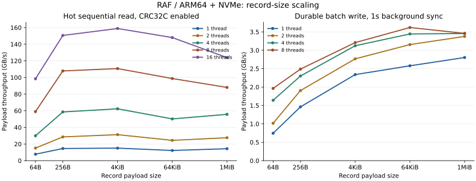

# RAF 性能报告

机器：Linux 6.17 / ARM64，10 个 Cortex-X925 + 10 个 Cortex-A725，121GiB RAM，Samsung MZALC4T0HBL1 4TB NVMe，ext4。GCC 13.3 / Release，CRC32C 实际路径为 ARM 硬件指令。CPU governor 为 performance，未固定线程亲和性；大小核调度和文件分配会产生波动。机器信息见 [environment.json](raw/environment.json)。

RAF 始终使用 Buffered I/O。fio 3.36 同时测 Direct/Buffered 两组、4KiB/1MiB、1/8 jobs、顺序读/随机读/顺序写，每项运行 1s 后统计 5s，psync、iodepth=1、独立文件。原始 fio 配置使用 invalidate=1；Buffered 读在循环回到文件开头时也会驱逐缓存，因此这组结果属于循环驱逐缓存的存储路径基线。这个 1s 运行阶段不能保证热缓存。所有基准仅操作临时测试文件。参数语义参考 [fio 官方文档](https://fio.readthedocs.io/en/latest/fio_doc.html)。fio 覆写已准备文件，RAF 创建新文件并追加，两者还存在文件分配、校验和格式开销差异。

下面带宽只统计 payload，MB/GB 均为十进制单位。读 TPS 是 Record 次数/秒；写 TPS 包含最终 seal 和两次同步。并发读共享一个 Reader 和同一个文件，并发写使用不同文件、每文件一个 Writer。热读前完整遍历预热，mincore 检查驻留；最终基准消费每个 payload 字节（64-bit XOR + 字节尾部），CRC 开/关采用相同消费方式。热读总吞吐属于逻辑 payload 处理速率，多个读者可共享缓存行，不能直接当作 DRAM 总线带宽。

## 4KiB / 1MiB 主结果

每格为 **TPS / MB/s**。读取 CRC 开启；写入 Batch=256、默认 1s 背景同步。每次写入 2GiB 总 payload，热读使用 512MiB 文件、计时 1s；以下取 3 次测量的中位数。

| Record | 并发 | READ 随机热读 | READ 顺序热读 | WRITE 顺序持久化 |
|---|---:|---:|---:|---:|
| 4KiB | 1 | 1,809,191 / 7,410.4 | 3,656,767 / 14,978.1 | 697,356 / 2,856.4 |
| 4KiB | 8 | 12,092,228 / 49,529.8 | 28,481,990 / 116,662.2 | 1,023,148 / 4,190.8 |
| 1MiB | 1 | 13,476 / 14,130.6 | 13,687 / 14,352.4 | 2,710 / 2,841.4 |
| 1MiB | 8 | 75,234 / 78,888.8 | 80,175 / 84,069.2 | 4,129 / 4,329.1 |

## fio 存储基线

每格为 **IOPS / MB/s**。4KiB 的队列深度仅为每线程 1；该结果反映请求延迟，不代表 SSD 在高队列深度下的最大 IOPS。

| I/O | Block | 并发 | 随机读 | 顺序读 | 顺序写 |
|---|---|---:|---:|---:|---:|
| Direct | 4KiB | 1 | 3,641 / 14.9 | 4,031 / 16.5 | 3,944 / 16.2 |
| Direct | 4KiB | 8 | 32,501 / 133.1 | 31,667 / 129.7 | 33,616 / 137.7 |
| Direct | 1MiB | 1 | 2,856 / 2,994.8 | 7,074 / 7,417.6 | 6,547 / 6,865.2 |
| Direct | 1MiB | 8 | 11,166 / 11,708.4 | 11,054 / 11,590.7 | 11,404 / 11,958.2 |
| Buffered | 4KiB | 1 | 4,201 / 17.2 | 468,815 / 1,920.3 | 230,865 / 945.6 |
| Buffered | 4KiB | 8 | 32,484 / 133.1 | 2,453,988 / 10,051.5 | 973,949 / 3,989.3 |
| Buffered | 1MiB | 1 | 318 / 333.0 | 2,196 / 2,302.6 | 5,336 / 5,594.7 |
| Buffered | 1MiB | 8 | 2,562 / 2,686.6 | 9,641 / 10,109.2 | 10,560 / 11,072.7 |

在主要 RAF 矩阵和重复测量后，使用相同参数复测 1MiB Direct 顺序读/写，检查存储基线随时间的变化：

| 并发 | 顺序读 GB/s（初始 / 末尾） | 顺序写 GB/s（初始 / 末尾） |
|---|---:|---:|
| 1 | 7.418 / 5.231 | 6.865 / 5.479 |
| 8 | 11.591 / 10.346 | 11.958 / 11.883 |

基线出现时段变化；以下预设目标仍按初始基线判断，保留原始目标和未达标结果。末尾复测另用于对照持续写入。

### Buffered I/O 与热缓存的区别

2026-10-12 补测：维持 psync / iodepth=1 / 1MiB / 每 Job 独立 2GiB 文件 / 1s 运行 + 5s 统计，仅改变缓存策略。冷路径保留 invalidate=1；热路径先用 buffered read 完整预读所有参与文件，用 mincore 确认全部页面驻留，再使用 invalidate=0。每项单次诊断，未绑定 CPU，不替换前面的重复主结果。

| 并发 | 循环驱逐缓存 GB/s | 完整预热保留缓存 GB/s | 设备实际读 GB（循环驱逐 / 热缓存） |
|---:|---:|---:|---:|
| 1 | 2.455 | 28.913 | 14.848 / 0.000 |
| 8 | 11.137 | 113.747 | 67.194 / 0.000 |

设备计数来自整个 nvme0n1，观察窗口包含 fio 启动和 1s 运行阶段，热路径的完整预读在该窗口之前完成；它可能包含其他进程 I/O。各热缓存测量前的驻留页都等于文件总页，测量窗口内设备读计数没有增长。

fio 3.36 的 [loop_cache_invalidate 与顺序读回绕逻辑](https://github.com/axboe/fio/blob/fio-3.36/io_u.c#L315-L360) 会在 time_based 顺序读到达文件尾时再次执行缓存驱逐；普通文件通过 [POSIX_FADV_DONTNEED](https://github.com/axboe/fio/blob/fio-3.36/filesetup.c#L571-L601) 实现。因此初始表中的 10.109GB/s Buffered 读不能解释为 Page Cache 热读上限，也不能据此宣称 RAF 热读比 fio 热读快一个数量级。

若使用 fio 自带预热，可设置 `--direct=0 --invalidate=0 --pre_read=1`；[pre_read 文档](https://fio.readthedocs.io/en/latest/fio_doc.html#cmdoption-arg-pre-read) 明确说明完整预读会清除 invalidate 标志。

完整预热后仍需区分路径：fio psync 将 Page Cache 数据复制到用户缓冲；RAF mmap 直接访问映射，并执行 CRC 与 payload 消费。fio 此处是 8 个独立文件、共 16GiB；RAF 的并发热读共享一个 512MiB payload 文件，两者的缓存共享、复制和计算成本不同。

原始补测参数、驻留页及计数见 [fio-cache-diagnostic/summary.json](raw/fio-cache-diagnostic/summary.json)，输出见 [fio-cache-diagnostic.log](raw/fio-cache-diagnostic.log)。

### 同文件同亲和性的 mmap 对照

fio 支持 mmap 引擎。fio 3.36 的 [mmap 读取实现](https://github.com/axboe/fio/blob/fio-3.36/engines/mmap.c#L214-L224) 仍将映射数据 memcpy 到 I/O 缓冲，RAF 关闭 CRC 时则在映射上直接进行完整 XOR 扫描；两者的目的缓冲写入和消费工作量不同。

补测统一使用同一个含 512MiB payload 的 Archive、1MiB 操作、相同大核亲和性、5s 测量窗口。单线程固定 CPU 5，8 线程固定 CPU 5/6/7/8/16/17/18/19。fio 使用 invalidate=0 / pre_read=1 / fadvise_hint=0，保留 1s 统计前运行；RAF 使用既有完整预热。所有线程读取同一文件，CRC 关闭。每项一次诊断。

| 线程 | fio psync GB/s | fio mmap GB/s | RAF mmap + XOR GB/s | 普通 mmap + 同样 XOR GB/s |
|---:|---:|---:|---:|---:|
| 1 | 30.358 | 32.850 | 28.944 | 28.829 |
| 8 | 146.638 | 129.373 | 156.373 | 156.188 |

fio 读取文件前 512MiB 的原始字节，RAF 统计 512MiB payload；每条 Record 的 12B 和每项 Offset 的 8B 导致约 0.002% 的覆盖差异。普通 mmap 基线从现有 benchmark 提取完全相同的 consume 函数，扫描前 512MiB，每 64 个 1MiB 块检查时间，与 RAF 相同；它没有 RAF 索引/API 操作。参考代码按相同 GCC Release 优化选项编译，并已按项目 .clang-format 格式化。

同文件比较的六项 fio/RAF 测量在整个进程窗口内均未观察到块设备读计数增长。普通 mmap 基线使用另一个同样生成、预热的 Archive。两组都是逻辑处理吞吐；共享缓存会减少底层实际内存读取，不能将总数直接解释为 DRAM 总线流量。

这些结果证明实现具备普通 mmap 扫描的吞吐量级，并展示消费方式对比较的影响。单次诊断不能量化复制、缓存行为、指令实现及 fio 记账各自的贡献，也不能据此断言 RAF 在所有 fio 引擎和负载上都更快。

数据：[同文件 fio/RAF](raw/fio-mmap-matched-read/summary.json)、[普通 mmap 基线](raw/mmap-scan-reference.json)、[基线源文件](raw/mmap-scan-reference.cpp)。此前共享/独立文件探索保留在 [fio-raf-matched-read/summary.json](raw/fio-raf-matched-read/summary.json)；其中部分 fio 启动阶段有设备读取，不替代本节明确预读的对照。

## 优化前后

R1 为便携查表 CRC，R2 为运行时硬件 CRC；文件格式和写入架构相同。两轮均使用修正后的完整 payload 消费方式、128MiB 写预算 / 256MiB 读文件 / 0.4s 热读，单次探索测量。旧的 cache-line sampling 结果仍保留在 portable/hardware/matrix.jsonl，仅作历史记录，不用于下面结论。

| 场景 | R1 GB/s | R2 GB/s | 倍率 |
|---|---:|---:|---:|
| crc-64-r0 | 0.732 | 12.470 | 17.02x |
| crc-4096-r0 | 0.556 | 29.864 | 53.75x |
| crc-1048576-r0 | 0.553 | 30.851 | 55.78x |
| write-4096-n1-b1-r0 | 0.297 | 0.839 | 2.82x |
| write-4096-n1-b256-r0 | 0.454 | 1.902 | 4.19x |
| write-1048576-n1-b256-r0 | 0.466 | 2.052 | 4.40x |
| read-4096-sequential-n1-r0 | 0.541 | 15.005 | 27.72x |
| read-1048576-sequential-n1-r0 | 0.533 | 14.511 | 27.25x |
| read-1048576-sequential-n8-r0 | 4.214 | 63.020 | 14.95x |

R3 是背景同步正确性修正：连续大 Batch 下，后台原先会等待追加 mutex；完成数改为原子发布，后台使用原有同步 mutex 独立工作。以下两次均为 8 Writer / 64GiB / 1s 背景同步。同步次数扣除最终每个文件的两次封装同步。

| 版本 | 实际成功背景同步次数 | 持久化 GB/s |
|---|---:|---:|
| 修正前 | 0 | 11.262 |
| 修正后 | 18 | 11.102 |

这项修正确保设计要求的后台持久化实际执行；它不是以牺牲持久性换吞吐的优化。新加入的确定性故障注入测试也验证了背景进度及在途追加收到同步错误。

Batch 减少小 Record 的 syscall 次数；下表仍为 2GiB、3 次中位数，且包含最终同步。

| Record | 并发 | Single GB/s | Batch GB/s | Batch/Single |
|---|---:|---:|---:|---:|
| 4KiB | 1 | 1.223 | 2.856 | 2.34x |
| 4KiB | 8 | 2.937 | 4.191 | 1.43x |
| 1MiB | 1 | 2.683 | 2.841 | 1.06x |
| 1MiB | 8 | 4.233 | 4.329 | 1.02x |

## 尺寸与并发矩阵

完整矩阵为 246 项：96 项写入（Single/Batch × 背景同步开/关 × 1/2/4/8 Writer）、120 项热读（顺序/随机 × CRC 开/关 × 1/2/4/8/16 Reader）、24 项初始冷缓存读及 6 次数据集写入。每项写入 256MiB 总 payload，读文件 512MiB，热读计时 0.4s。这组短测量用于趋势分析，封装固定成本对大量小文件影响明显；主结论采用上面的较长重复测量。混合长度按 64B/256B/4KiB/64KiB/1MiB 循环，带宽按实际字节统计。

以下为 **顺序热读 GB/s（CRC 开 / 关）**：

| Record | 1 线程 | 2 线程 | 4 线程 | 8 线程 | 16 线程 |
|---|---:|---:|---:|---:|---:|
| 64B | 7.75 / 12.01 | 15.13 / 22.80 | 29.91 / 45.16 | 59.00 / 91.95 | 98.45 / 115.71 |
| 256B | 14.60 / 28.14 | 28.56 / 55.52 | 58.56 / 96.80 | 107.88 / 138.39 | 150.58 / 134.95 |
| 4KiB | 15.06 / 31.98 | 31.27 / 58.78 | 62.34 / 94.61 | 110.71 / 138.23 | 158.90 / 156.47 |
| 64KiB | 12.24 / 28.98 | 24.41 / 56.52 | 50.19 / 107.37 | 98.75 / 162.82 | 148.01 / 162.97 |
| 1MiB | 14.34 / 28.54 | 27.56 / 55.94 | 55.70 / 102.80 | 88.02 / 160.29 | 123.89 / 144.66 |
| 混合 | 14.22 / 28.33 | 27.70 / 45.88 | 55.99 / 110.94 | 102.93 / 146.30 | 124.44 / 152.29 |

以下为 **Batch 持久化写 GB/s（背景同步开 / 关）**：

| Record | 1 Writer | 2 Writer | 4 Writer | 8 Writer |
|---|---:|---:|---:|---:|
| 64B | 0.74 / 0.72 | 1.02 / 0.99 | 1.64 / 1.56 | 1.96 / 1.95 |
| 256B | 1.46 / 1.43 | 1.91 / 1.92 | 2.30 / 2.28 | 2.49 / 2.57 |
| 4KiB | 2.34 / 2.26 | 2.77 / 2.80 | 3.12 / 3.22 | 3.21 / 3.36 |
| 64KiB | 2.58 / 2.60 | 3.15 / 2.80 | 3.44 / 3.24 | 3.62 / 3.44 |
| 1MiB | 2.80 / 2.73 | 3.38 / 3.18 | 3.46 / 3.00 | 3.46 / 3.26 |
| 混合 | 2.46 / 2.70 | 3.13 / 3.08 | 3.21 / 3.42 | 3.53 / 2.93 |

曲线使用本节短测矩阵，左图为 CRC 开启的顺序热读，右图为默认背景同步的 Batch 持久化写入；展示五种固定长度，不包含混合长度。

可下载 [SVG](performance-curves.svg) 或 [PNG](performance-curves.png)。

## 初始冷缓存对照

通过文件级 POSIX_FADV_DONTNEED 请求驱逐，并用 mincore 记录计时前驻留页；不修改系统级 drop_caches。Reader 构造加载 Index 的时间单独记录。顺序执行一个遍历；随机发起与 Record Count 相同次数的有放回请求，因此后续请求可命中已缓存数据。并发 Reader 还共享其他线程读入的页。这是初始冷缓存下的逻辑处理吞吐，不是所有请求都访问物理磁盘的吞吐。

| Record | 并发 | 冷随机 MB/s | 冷顺序 MB/s | 初始驻留页/总页（顺序） |
|---|---:|---:|---:|---:|
| 4KiB | 1 | 218.0 | 684.9 | 0/131,713 |
| 4KiB | 8 | 12,730.2 | 8,212.8 | 0/131,713 |
| 1MiB | 1 | 996.6 | 1,068.9 | 0/131,075 |
| 1MiB | 8 | 18,870.8 | 6,864.9 | 0/131,075 |

## 持续写入与同步

1MiB、Batch=256、1/8 Writer，每组 64GiB 总 payload，包含最终 Seal。每 200ms 记录写入进度、系统 Dirty/Writeback 和块设备写计数；不修改 VM 参数。当前 dirty_ratio=20%、dirty_background_ratio=10%；启动时 /proc/vmstat 的脏页阈值约为 24.5GB。

| Writer | 背景 Sync | Payload GB | Append GB/s | 持久化 GB/s | 实际设备写 GB/s | CPU % | Dirty 峰值 GB | fdatasync 最大 ms | 成功背景 Sync 次数 |
|---:|---|---:|---:|---:|---:|---:|---:|---:|---:|
| 1 | 关闭 | 68.72 | 7.371 | 6.707 | 6.708 | 92.6 | 12.28 | 921.25 | 0 |
| 1 | 1s | 68.72 | 7.086 | 6.578 | 6.579 | 102.9 | 12.01 | 1096.61 | 5 |
| 8 | 关闭 | 68.72 | 15.674 | 10.803 | 10.805 | 189.2 | 20.22 | 2010.18 | 0 |
| 8 | 1s | 68.72 | 15.070 | 11.102 | 11.104 | 221.6 | 18.24 | 2054.96 | 18 |

本次最高 Dirty 为 20.22GB。文件之外的只读 /proc 观察器在两组 8 Writer 测量中记录到 641 次线程等待采样落在 balance_dirty_pages，直接证明本次覆盖了 Dirty Throttling 阶段；这些是采样观察次数，不是 syscall 次数或精确阻塞时长。没有修改全局 VM 阈值。观察器只读取同一用户拥有的本次 RAF 大文件基准进程，证据见 [writeback-observer.jsonl](raw/writeback-observer.jsonl)。块设备计数是整台设备的观测，可能包含少量其他进程和文件系统日志写入。

## 延迟、CPU 与索引

下表采用主结果的 Batch 写入。延迟单位 µs，采样每 128 次 Append/Batch 调用一次；Batch 延迟是一整批的调用延迟，不能当作单 Record 的延迟。样本数较少的大 Record Case 的 P99 只能当作本次样本分位数，不能代表生产尾延迟。CPU 100% 表示一个核。

| Record | 并发 | P50 µs | P99 µs | 每次样本数 | CPU % | fdatasync 最大 ms |
|---|---:|---:|---:|---:|---:|---:|
| 4KiB | 1 | 162.21 | 645.95 | 16 | 50.9 | 411.11 |
| 4KiB | 8 | 255.82 | 407.07 | 16 | 98.5 | 459.29 |
| 1MiB | 1 | 41835.10 | 41835.10 | 1 | 44.6 | 456.74 |
| 1MiB | 8 | 68949.64 | 73393.85 | 8 | 119.4 | 426.87 |

短写测量的最终同步耗时有明显波动。以下比较相同 2GiB / 1MiB / Batch=256 的三次测量；追加耗时、CPU 时间取中位数，最大 fdatasync 耗时列展示三次结果的范围。

| 时段 | Writer | Append 秒 | CPU 秒 | 最大 fdatasync ms 范围 |
|---|---:|---:|---:|---:|
| 同步修正前 | 1 | 0.306 | 0.342 | 185.7–186.6 |
| 同步修正前 | 8 | 0.061 | 0.474 | 176.1–201.9 |
| 最终测量 | 1 | 0.300 | 0.340 | 402.1–1190.6 |
| 最终测量 | 8 | 0.076 | 0.592 | 410.9–1275.9 |

单 Writer 的追加耗时和 CPU 时间几乎不变；8 Writer 的追加耗时有所增加，但最终 fdatasync 的增长更大。持久化吞吐下降主要对应最终同步时间增加，存储基线也出现时段变化。现有计量不能确定同步波动的具体设备或文件系统原因，因此不能据此判定原子计数带来的性能变化。

主场景热读的 CPU 使用率如下，仍取三次中位数，100% 表示一个核。

| Record | 并发 | 随机热读 CPU % | 顺序热读 CPU % |
|---|---:|---:|---:|
| 4KiB | 1 | 100.0 | 100.0 |
| 4KiB | 8 | 799.8 | 799.8 |
| 1MiB | 1 | 100.0 | 100.0 |
| 1MiB | 8 | 798.2 | 797.7 |

Reader 索引逻辑占用严格为 8*N 字节；Writer 的 vector 容量按需增长，保留容量可能高于逻辑长度。512MiB payload 数据集的 Index：

| Record | Records | Index MiB | 打开耗时 ms |
|---|---:|---:|---:|
| 64B | 8,388,608 | 64.000 | 28.42 |
| 256B | 2,097,152 | 16.000 | 10.23 |
| 4KiB | 131,072 | 1.000 | 0.46 |
| 64KiB | 8,192 | 0.062 | 0.05 |
| 1MiB | 512 | 0.004 | 0.02 |
| 混合 | 2,400 | 0.018 | 0.02 |

## 预先设定目标的达成情况

在 RAF 测量前，计划设定大 Record 持久化写 ≥ 同并发 fio Direct 顺序写的 70%，热 CRC 顺序读 ≥ fio Direct 顺序读的 2 倍。以下使用主结果的三次中位数：

| 并发 | 写目标 GB/s | 实际写 GB/s | 写是否达成 | 热读目标 GB/s | 实际热读 GB/s | 读是否达成 |
|---|---:|---:|---|---:|---:|---|
| 1 | 4.806 | 2.841 | 否 | 14.835 | 14.352 | 否 |
| 8 | 8.371 | 4.329 | 否 | 23.181 | 84.069 | 是 |

对持续写入目标，另外使用默认同步的 64GiB 测量，仍包含最终封装：

| Writer | 实际 GB/s | 初始 70% 写目标 | 达成 | 占末尾 fio 写带宽 |
|---:|---:|---:|---|---:|
| 1 | 6.578 | 4.806 | 是 | 120.1% |
| 8 | 11.102 | 8.371 | 是 | 93.4% |

瓶颈解释：便携逐字节 CRC 原先限制大 Record；硬件 CRC 明显提升读与写。小 Record 的 Single Append 主要受 syscall 和每条元数据开销影响，Batch 聚合有利。随机小 Record 还受 Index/Payload 缓存未命中影响。热读最终包含 CRC 和全 payload 消费两次读取，大线程数的总量会受共享缓存及内存访问模式影响。写入需要 CRC、用户态到 Page Cache 的复制、页分配、文件扩展及持久化；快速 NVMe 的 Direct 覆写基线不能消除这些成本。未达到的目标如表如实保留，没有为提高数字改变指定的文件格式或 Buffered I/O 架构。

限制：短窗口和异构核存在噪声；未测生产负载下的稳定 P99，未做真实断电或设备写缓存保证测试，没有精确统计 Dirty Throttling 的阻塞时长。CPU 使用率和设备计数是观测，不是硬件事件级瓶颈剖析。CRC 关闭仅用于比较，应按调用方的数据完整性要求选择。

可复现命令和全部实际计数保存在每行 JSON 的 command 字段。原始数据：[初始 fio](raw/fio/summary.json)、[末尾 fio](raw/fio-final/summary.json)、[最终全矩阵](raw/matrix-final.jsonl)、[三次重复主测量](raw/focused.jsonl)、[8 Writer 持续写入](raw/sustained.jsonl)、[单 Writer 持续写入](raw/sustained-single.jsonl)、[便携 CRC](raw/portable-final.jsonl)、[硬件 CRC](raw/hardware-final.jsonl)。使用 `python3 bench/make_report.py` 重建此报告。
